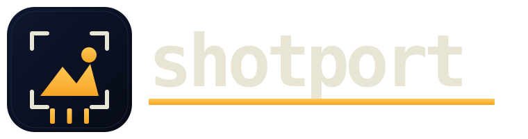

<p align="center">
  
</p>

<p align="center"><em>Token-cheap screenshot capture for coding agents.</em></p>
<p align="center"><strong>Text first. Budgeted pixels only when needed.</strong></p>

<p align="center">
  <a href="https://github.com/edihasaj/shotport/actions/workflows/ci.yml"></a>
  
  
  
</p>

---

`shotport` does the heavy screenshot work for coding agents: capture through the right local tool, extract text first, resize the image to a token budget, then print a compact result.

The default output is intentionally cheap:

```text
target: browser https://example.com · 1280x720 webp -> /tmp/shotport-x/capture.webp (~1.2k img tokens)
TEXT (a11y):
Example Domain
...
```

Agents read the text from stdout and only open the image path when pixels are actually needed. This is the automation layer for the screenshot-token cost that [`spendwatch`](https://github.com/edihasaj/spendwatch) surfaced: no more sending raw 4M+ token screenshots when a budgeted image plus accessibility/OCR text will do.

## Why

A single raw screenshot can cost millions of tokens. Most of the time an agent needs the *content* of the screen — a label, an error, a value — not the pixels. `shotport` inverts the default:

1. **Text first.** Pull accessibility text (or OCR) and print it to stdout. Often that's the whole answer.
2. **Budgeted pixels.** When pixels matter, resize the image to fit an approximate token budget before it ever reaches the model.
3. **One compact line.** A stable summary line the agent can parse, plus the image path to open on demand.

## Attach the current window

Instead of dragging a screenshot into your agent like a caveman, hand it the **frontmost window** in one command:

```sh
shotport window
```

No app name needed — `shotport` resolves whatever is focused, dumps the window's full accessibility tree (**including text scrolled out of view**, when the app exposes it), and budgets a screenshot only if you ask for pixels. Pair it with `--full-text` to keep the entire window text:

```sh
shotport window --full-text --text-only
```

This is the agent-facing version of "attach my current window" — text first, so the model usually doesn't need the pixels at all.

## Install

Homebrew is recommended. On macOS it installs guiport as the single signed
Screen Recording and Accessibility permission owner.

```sh
brew install edihasaj/tap/shotport
shotport doctor
```

Building from source requires [Bun](https://bun.sh).

```sh
# Build + install the standalone binary to /opt/homebrew/bin
bun install
bun run install:local
```

Or step by step:

```sh
bun install
bun run build
install -m 0755 ./dist/shotport /opt/homebrew/bin/shotport
```

One-liner from source:

```sh
curl -fsSL https://raw.githubusercontent.com/edihasaj/shotport/main/scripts/install.sh | sh
```

The binary is standalone after compilation. Runtime backends are checked gracefully:

- [`abx`](https://github.com/edihasaj/abx) for browser capture, accessibility text, selectors, and clips
- [`guiport`](https://github.com/edihasaj/guiport) for macOS app/desktop screenshots, accessibility text, and the single macOS permission identity. Installed automatically by Homebrew.
- `sips`, `xcrun simctl`, and `adb` for native processing and device capture
- Apple Vision via `swift`, then `tesseract`, for OCR fallback
- `cwebp` for WebP output when requested

Missing a backend never crashes a run — `shotport` returns whatever it can and notes what was unavailable.

## Usage

```sh
shotport window [--window <title>] [--region x,y,w,h] [flags]
shotport browser <url|-> [--element <sel>] [--clip x,y,w,h] [flags]
shotport app <name> [--window <title>] [--region x,y,w,h] [flags]
shotport desktop [--region x,y,w,h] [flags]
shotport ios [flags]
shotport android [flags]
```

Flags:

```text
--text-only          Print extracted text without writing a budgeted image
--image-only         Write image and skip text extraction
--json               Emit stable JSON
--out <path>         Output image path; default is a temp file
--budget <tokens>    Resize image to fit approximate token budget
--max-px <pixels>    Max long edge before token budgeting (default: 1280)
--max-chars <n>      Cap extracted text length (default: 6000)
--full-text          Keep all extracted text — don't truncate
--jpeg               Convert budgeted image to JPEG
--webp               Convert budgeted image to WebP when cwebp exists
```

Examples:

```sh
shotport window
shotport window --full-text --text-only
shotport browser https://example.com --element main --budget 900 --webp
shotport app Calculator --window Calculator
shotport desktop --region 0,0,1200,800 --json
shotport ios --budget 1200 --jpeg
shotport android --text-only
```

## Backends

Window flow (the frontmost app, no name needed):

1. `guiport apps --json` → pick the active app that owns a window
2. `guiport tree --app <name>` for the full focused-window text
3. `guiport screenshot --app <name> -o <path>` for budgeted pixels

Browser flow:

1. `abx goto <url>`
2. `abx wait --networkidle`
3. `abx accessibility`
4. `abx screenshot [--clip x,y,w,h] [selector] <path>`

App flow:

1. `guiport tree --app <name> [--window <title>]`
2. `guiport screenshot --app <name> [--window <title>] -o <path>`
3. `sips` crops the guiport image locally when `--region` is used

Desktop flow uses `guiport screenshot`; it never falls back to another macOS
capture identity. iOS uses `xcrun simctl io booted screenshot`. Android uses
`adb exec-out screencap -p` and returns a clean missing-backend note when `adb`
is absent.

On macOS, run **`shotport doctor`** once after installing. It delegates to
`guiport doctor --fix`, so only the signed guiport app requests Screen Recording
and Accessibility. Shotport does not create another macOS permission entry. If
permission is missing at capture time, shotport keeps the run useful by returning
any available accessibility text plus a note such as
`screen_recording_not_granted`.

## Development

```sh
bun install
bun test
bun run typecheck
bun run build
```

See [CONTRIBUTING.md](CONTRIBUTING.md) for the contribution wedge and PR checklist.

No analytics. No secrets. MIT licensed.

## License

MIT — see [LICENSE](LICENSE).

## Author

[Edi Hasaj](https://edihasaj.com)
